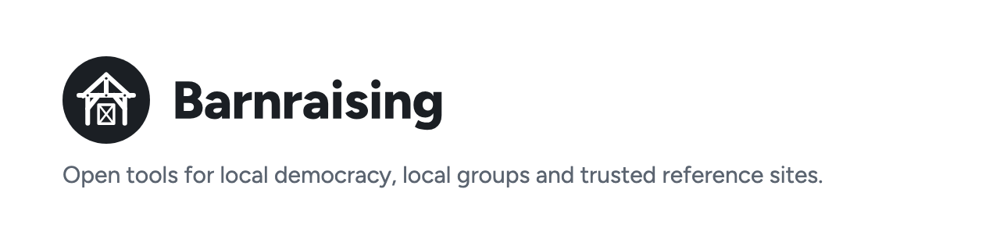

<picture>
  <source media="(prefers-color-scheme: dark)" srcset="https://raw.githubusercontent.com/barnraising-foundation/.github/main/profile/assets/banner-dark.png">
  <source media="(prefers-color-scheme: light)" srcset="https://raw.githubusercontent.com/barnraising-foundation/.github/main/profile/assets/banner-light.png">
  
</picture>

Barnraising builds open tools that help people follow their local government and find the groups working in their town. The work runs through three programs.

Townwright makes city hall easier to follow. Council Loop turns council meetings into plain-language recaps, audio and translations. Open Site Content lets a city publish its website once as clean content anyone can read. The Civic Connection Layer lets local groups post their details once and have them show up on the maps and calendars people already use.

Freehold is an open platform where anyone can run a server for group apps built on open standards. Its groups bundle, Meetinghouse, is an open replacement for Facebook Groups and Events.

Almanac gathers trusted reference sites, starting with [Ask About Vaccines](https://askaboutvaccines.org) and the Civic Research Commons.

Our tools are open and exportable by default. Most of these projects are still in private development, and their repositories will open here as each one launches.
